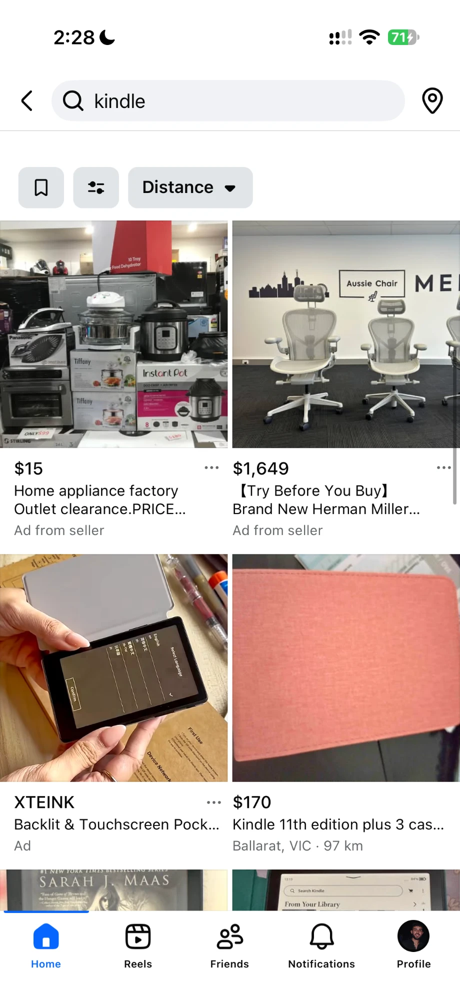
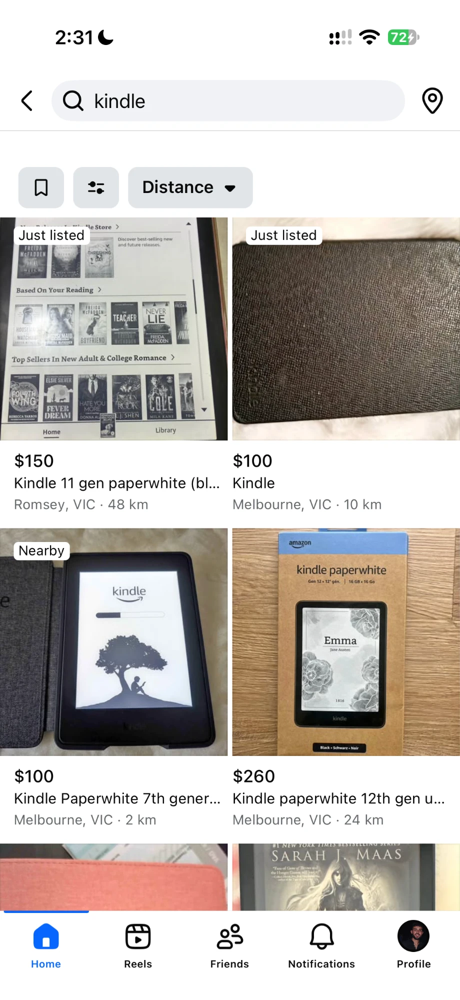
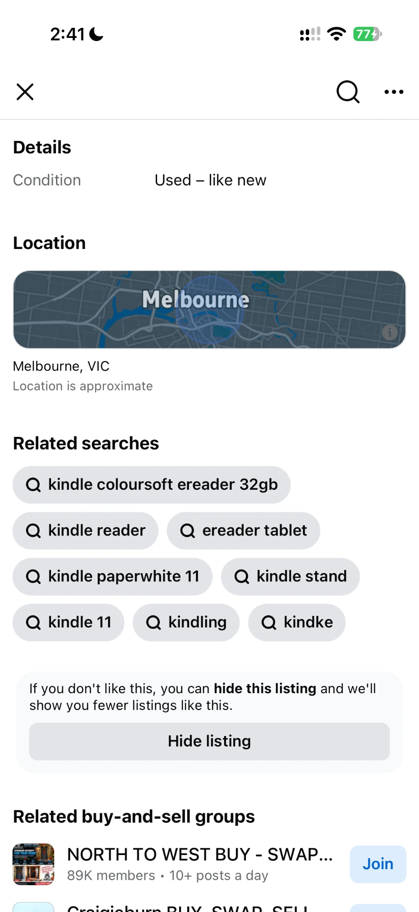

# MarketplaceAdBlock

This tweak removes ads from Facebook Marketplace on iOS.

Other tweaks remove ads from the main feed. They do not remove ads from Marketplace. This tweak removes ads from these Marketplace pages:

- Home feed
- Search results
- Listing pages ("Related ads")

## Screenshots

| | Before | After |
|---|---|---|
| Search |  |  |
| Listing |  |  |

## How it works

Marketplace uses React Native. The app gets its data with GraphQL requests through `RCTNetworking`. Each request has a query name.

The tweak changes `-[RCTNetworking handlerForRequest:]`. It does two things:

1. It stops the ads queries. These queries have names such as `MarketplaceHomeFeedAdsQueryRendererQuery` and `MarketplacePDPPersonalizedAdsQuery`.
2. It filters the feed and search responses. It removes each item that has an ad type, such as `MarketplaceFeedAdStory`.

The tweak does not change normal listings.

The tweak uses only the Objective-C runtime. It does not need Substrate or ElleKit.

## Download

Get the dylib from the [latest release](https://github.com/adamsardo/MarketplaceAdBlock/releases/latest).

- `MarketplaceAdBlock.dylib`: Use this file.
- `MarketplaceAdBlock-debug.dylib`: This file also logs all query names and item types. Use it only for troubleshooting.

## Build

You can build the dylib yourself. You must have Xcode with the iOS SDK.

1. Run `./build.sh`.
2. Get `MarketplaceAdBlock.dylib` from this folder.

To log all query names and item types, run `MPAB_LOG_ALL=1 ./build.sh`.

## Install

1. Get a decrypted Facebook IPA. This repository does not include the IPA.
2. Inject `MarketplaceAdBlock.dylib` into the IPA. Use a sideload tool, for example FlareStore.
3. Install the IPA on your device.

## Install as a jailbreak tweak (.deb)

On a jailbroken device, you can install the tweak as a package instead. ElleKit or Substrate then loads it into the App Store Facebook app. You do not need to inject an IPA.

You must have Xcode with the iOS SDK, `ldid`, and `dpkg`. On a Mac, run `brew install ldid dpkg`.

1. Run `packaging/package.sh` for a rootless jailbreak, for example Dopamine or palera1n rootless. For a rootful jailbreak, run `packaging/package.sh rootful`.
2. Get the `.deb` file from the `packages` folder.
3. Install the `.deb` with Sileo, Zebra, or `dpkg -i`.
4. Close Facebook and open it again.

The script runs `build.sh` if `MarketplaceAdBlock.dylib` does not exist. To set the package version, add it after the scheme, for example `packaging/package.sh rootless 1.0.1`. The default version is the latest git tag.

## Tested with

- Facebook iOS 584.0.0
- iOS 27.2 beta
- FlareStore, with "Enable ElleKit" set to off

## Troubleshooting

If you see ads after a Facebook update, do these steps:

1. Inject `MarketplaceAdBlock-debug.dylib`, or build with `MPAB_LOG_ALL=1`.
2. Open Console.app on your Mac.
3. Connect your device.
4. Filter on `MPAdBlock`.
5. Open Marketplace.
6. Find the new query names or ad types in the log.
7. Add them to `Tweak.m`.

## Disclaimer

This is a personal project. It is not related to Meta. Use it at your own risk.
